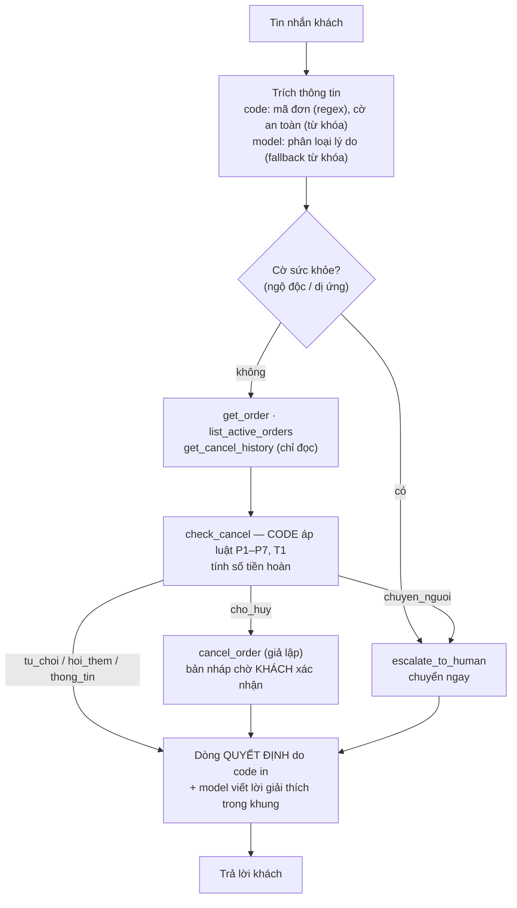

# Nội dung Slide trang 1–3 — Nhóm NoName (Track D1)

- **Mục đích:** Bản thảo nội dung chi tiết cho trang 1–3 của bộ slide CP4 (`demo-slides.pdf`, hạn 14:30 Thứ Bảy 28/11/2026), tuân thủ cấu trúc tại [slides/outline.md](outline.md) (*mỗi trang có ≥1 con số hoặc trích dẫn có nguồn*).
- **Trạng thái:** Đã tổng hợp từ dữ liệu thật trong repo; chờ ghép vào deck chung cùng trang 4 (demo), trang 5, 7, 8 (Đức) và trang 6 (Khoa) để xuất `demo-slides.pdf`.
- **Phụ trách:** Dương Tuấn Hưng.

---

## Trang 1 — Người dùng & Pain

**Nguồn tham chiếu:** [evidence/summary.md](../evidence/summary.md), [evidence/data-mining.md](../evidence/data-mining.md), [evidence/survey/questions.md](../evidence/survey/questions.md), [spec.md](../spec.md) §1.

### Nội dung hiển thị trên slide
- **Ai:** Sinh viên 18–24 tuổi đặt đồ ăn ShopeeFood, **thanh toán trước** (ShopeePay / thẻ).
- **Việc cố làm xong:** Hủy đơn vừa đặt và biết ngay **có hủy được không, hoàn bao nhiêu tiền, khi nào**.
- **Chỗ đau hiện tại:**
  - Nút hủy bị mờ không giải thích; không cảnh báo trước hủy vì đổi ý mất tiền/Xu/mã.
  - Phải chat hỗ trợ chậm/trả lời mẫu, hoặc chờ kiểm tra hoàn tiền **1–3 ngày làm việc**.
- **Bằng chứng 3 nguồn:**
  - **220 review 1–2★ Google Play** (đọc tay, 27/11/2026): **34/220 (15,5%)** nhắc hủy đơn · **23/220 (10,5%)** than không cho hủy · **5/220 (2,3%)** trừ tiền/không hoàn *(lưu ý: chỉ lấy review 1–2★)*.
  - **Khảo sát n = 20** *(9 học viên L3, 7 sinh viên 18–24, 4 người đi làm; 14/20 = 70% dùng thanh toán trước)*: **13/20 (65%)** không biết hủy vì đổi ý mất tiền/Xu/mã · **13/20 (65%)** chưa biết rõ nút hủy bị mờ sau khi quán xác nhận · **14/20 (70%)** mất **5–30 phút** xử lý · **5/20 (25%)** không hủy được phải nhận hàng · **4/20 (20%)** từng hoàn chậm/chưa hoàn.
  - **3 phỏng vấn ngoài nhóm (P1–P3):** P3 bị chặn hủy sau xác nhận (>20 phút, không hoàn); P2 đơn báo lỗi bị từ chối hoàn (10 phút); P1 hủy sớm khi đơn đang chờ thì được hoàn.
- **Trích dẫn nguyên văn (đã ẩn danh):**
  - *“Để giống nhau, ấn nhầm mua deal còn không cho hủy. … Sinh viên làm gì có nhiều tiền mà mua.”* — `R1-074` (1★, 01/11/2026)
  - *“50p không có tài xế mà lại không cho hủy đơn. yêu cầu hủy thì đe doạ ngược lại ảnh hưởng tài khoản?”* — `R1-110` (1★, 25/10/2026)
  - *“Ko có thông tin hỗ trợ đầy đủ”* (Phiếu #1) · *“lâu mất thời gian, thời gian hoàn tiền lâu”* (Phiếu #5)

### Ghi chú lời nói (~35 giây)
Nhóm tập trung vào sinh viên 18–24 tuổi đặt ShopeeFood thanh toán trước và muốn hủy đơn. Thực tế, người dùng thường gặp cảnh nút hủy bị mờ không rõ lý do, không biết đổi ý sẽ mất tiền/Xu/mã, và tốn nhiều thời gian chờ chat hoặc chờ đối soát hoàn tiền. Trong 220 review 1–2 sao trên Google Play, 15,5% nhắc đến vấn đề hủy đơn; khảo sát 20 người cho thấy 65% chưa biết rõ quy định mất tiền khi đổi ý và nút hủy bị mờ, đồng thời 70% tốn 5–30 phút để xử lý một lần muốn hủy.

---

## Trang 2 — Vì sao chọn bài này: Impact & hướng bị loại

**Nguồn tham chiếu:** [spec.md](../spec.md) §2, [evidence/data-mining.md](../evidence/data-mining.md).

### Nội dung hiển thị trên slide
- **Quy mô tham chiếu:** ~700 học viên L3 (`02-guide.md` §4.2), giả định 60% đặt ShopeeFood ≥1 lần/tuần ≈ 420 người *(tự ước tính)*.

| Hướng | Tần suất / Bằng chứng | Impact / tháng *(tự ước tính)* | Quyết định | Vì sao |
|---|---|---|---|---|
| **Hủy đơn** | **34/220 (15,5%)** review | ~84 người × 1 lần × 15 phút ≈ **21 giờ** + ~10% ca mất 60.000đ ≈ **0,5 triệu đ** | **CHỌN** | Luật trạng thái P1–P7 có nguồn công khai, kiểm được bằng code |
| Giao trễ, chờ lâu | 67/220 (30%) review | ~210 người × 2 lần × 10 phút ≈ 70 giờ | **Loại** | ShopeeFood VN không công bố chính sách bù trễ → phải tự đặt toàn bộ chuẩn đạt; AI không rút ngắn giờ giao *(giữ tình huống muốn hủy vì chờ lâu làm câu thử `kho`)* |
| Thiếu món | **3/220 (1,4%)** review | ~21 người × 1 lần × 20 phút ≈ 7 giờ + 0,3 triệu đ | **Loại** | Giả thuyết ban đầu bị bác bỏ — dưới ngưỡng 15% |

- *Ghi chú phân biệt số liệu:* Tỷ lệ review 15,5% / 30% / 1,4% là số đếm thực tế từ 220 review 1–2★; các con số quy mô người gặp, số lần và số giờ/tiền tiết kiệm mỗi tháng là nhóm *(tự ước tính)*.

### Ghi chú lời nói (~30 giây)
Dù nhóm review giao trễ chiếm 30%, ShopeeFood không công bố chính sách bù trễ nên nếu chọn sẽ phải tự đặt toàn bộ luật, và AI cũng không làm tài xế chạy nhanh hơn. Còn giả thuyết ban đầu là thiếu món chỉ chiếm 1,4% review nên bị loại. Nhóm chọn bài toán hủy đơn vì chiếm 15,5% review, có luật trạng thái P1–P7 công khai để kiểm chứng bằng code, ước tính tác động khoảng 21 giờ và 0,5 triệu đồng mỗi tháng trên quy mô giả định 420 người đặt thường xuyên.

---

## Trang 3 — Giải pháp

**Nguồn tham chiếu:** [spec.md](../spec.md) §4, [codebase/agent.py](../codebase/agent.py), [codebase/tools.py](../codebase/tools.py), [README.md](../README.md).

### Nội dung hiển thị trên slide
- **Lát cắt một câu:** Một sinh viên · yêu cầu hủy đơn ShopeeFood đã thanh toán · hệ thống quyết định **cho hủy kèm số tiền hoàn / giải thích không hủy được kèm giờ giao dự kiến / chuyển nhân viên** · sinh viên biết ngay kết quả, số tiền và thời gian hoàn.
- **Sơ đồ luồng xử lý:**

- **Hình dạng: Workflow cố định** *(chọn thay vì agent tự do)* — chỉ có 1 quyết định trung tâm theo luật rõ ràng; rẻ hơn, đo lường ổn định hơn và tránh rủi ro model tự gọi `cancel_order` sai lúc.
- **Mức tự động: AI tự làm khi chắc, chuyển người khi không** + **4 lớp chặn rủi ro:**
  1. **Code quyết, model diễn đạt:** `check_cancel` (code) áp luật P1–P7, T1 và tính tiền hoàn; model `gpt-5.4-nano` (2 lời gọi/câu) chỉ phân loại lý do và viết lại lời giải thích.
  2. **Khóa đầu ra:** Dòng `QUYẾT ĐỊNH` và `Số tiền được hoàn` do code in cứng (`header()`), model không sửa được; `check_llm` hậu kiểm chống rơi dữ kiện, số tiền lạ, cụm cấm (`voucher`, `boi thuong`, `cam ket`…) hay hứa hoàn sai P5.
  3. **Tác động ra ngoài chỉ tạo nháp:** `cancel_order` chỉ trả `ban_nhap_cho_khach_xac_nhan` để khách tự bấm; thiếu mã đơn hoặc thiếu lý do thì hỏi thêm (`hoi_them`, nguyên tắc G10).
  4. **Chuyển nhân viên bắt buộc (`escalate_to_human`):** Ngộ độc/dị ứng (ưu tiên trước mọi luật), trừ tiền không có đơn, quá 3 ngày làm việc chưa hoàn, đòi bồi thường/vượt giá trị đơn, hoặc quán trễ >30 phút khi món còn ở quán (luật tự đặt T1).
- **Minh bạch thật/giả:** Gọi model `gpt-5.4-nano` thật và áp luật P1–P7 thật; dữ liệu 17 đơn / 4 khách (`seed 15`) và hai hàm `cancel_order`, `escalate_to_human` là giả lập.

### Ghi chú lời nói (~45 giây)
Giải pháp của nhóm đi theo một workflow cố định: code kiểm tra cờ sức khỏe và tấn công trước, sau đó đọc dữ liệu đơn và tự tính quyết định cũng như số tiền hoàn theo luật P1–P7 và T1 trong `check_cancel`. Model `gpt-5.4-nano` chỉ làm hai việc là phân loại lý do hủy và diễn đạt câu trả lời từ bản nháp của code. Đầu ra có thêm lớp `check_llm` hậu kiểm để chặn việc model thêm voucher, hứa hoàn sai hoặc làm rơi mốc thời gian; còn thao tác hủy đơn chỉ dừng ở bản nháp chờ khách tự bấm xác nhận, các ca rủi ro cao như ngộ độc hay quá 3 ngày chưa hoàn được chuyển thẳng cho nhân viên.
