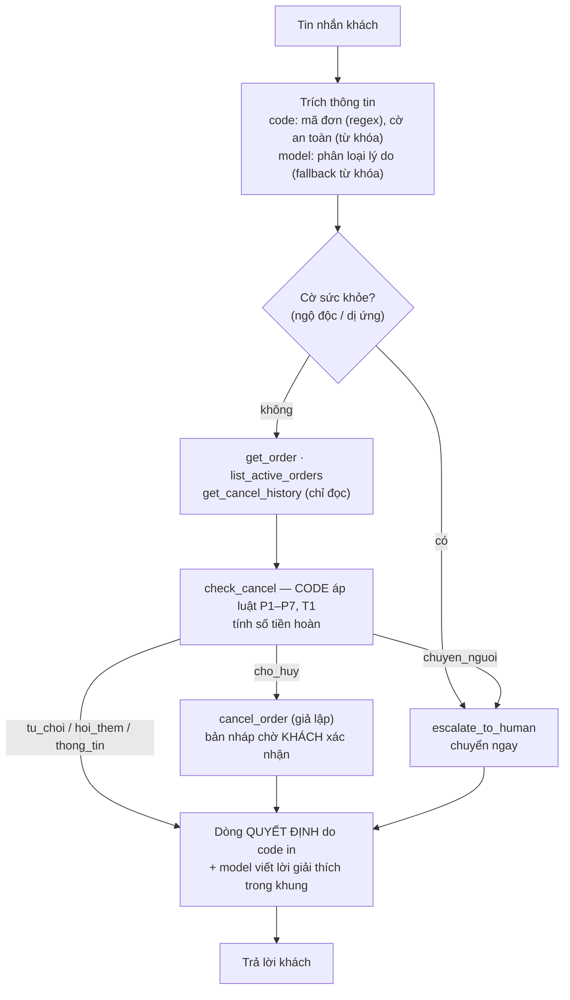

# AI SPEC — Yêu cầu hủy đơn ShopeeFood đã thanh toán · Nhóm NoName · Phòng H209 · Zone 3

> Mốc nộp: §7 chốt chuẩn "đạt" tại **CP2 19:30 Thứ Sáu 27/11** · §0–§7 nộp **CP3 10:00 Thứ Bảy 28/11** · đủ §0–§10 **CP4 14:30 Thứ Bảy 28/11** · §10 changelog ghi tiếp đến **23:59 Thứ Bảy 28/11**.
> Đầu mỗi mục ghi bước guide (`02-guide.md` trong repo đề) chỉ cách điền. Mỗi mục ngắn, có số và nguồn; chi tiết để ở file được trỏ tới. Xoá dòng hướng dẫn trong ngoặc vuông khi điền xong.

Track: [ ] A · [ ] B · [ ] C · [x] D · [ ] E — bài toán: D1 · Xử lý khiếu nại đơn giao đồ ăn → lát cắt: yêu cầu hủy đơn ShopeeFood đã thanh toán trước
Data BTC cấp đã dùng (nếu có — không commit nguyên file): không có (Track D không có data BTC). Dùng review công khai Google Play + trang trợ giúp ShopeeFood; data đơn hàng sẽ là data giả lập có seed.

## §0. Hiện tại việc này diễn ra thế nào *(guide 1.1)*
- Luồng hiện tại trên app ShopeeFood (theo Trung tâm Trợ giúp ShopeeFood, xem 27/11/2026; ảnh chụp từ tài khoản nhóm sẽ bổ sung):
  1. Khách đặt món, thanh toán trước (ShopeePay/thẻ) hoặc tiền mặt.
  2. Khách chỉ tự hủy được bằng nút **Hủy đơn hàng** ở cuối trang Chi tiết đơn hàng khi quán chưa xác nhận làm món hoặc chưa có tài xế nhận đơn (help.cs.shopeefood.vn/portal/102/article/71090).
  3. Khi nút hủy mờ (quán đã xác nhận / tài xế đang giao), ShopeeFood đề nghị khách tiếp tục đơn (article/71096); nếu quán làm món lâu, ShopeeFood đề nghị khách chờ thêm (article/71321).
  4. Muốn hủy sau đó → khách phải **Chat với ShopeeFood** và trao đổi với hỗ trợ.
  5. Đơn hủy vì khách đổi ý → không hoàn tiền, Shopee Xu, mã khuyến mãi (category/595/596). Đơn cần hoàn tiền / đã trừ tiền mà chưa hoàn thành → ShopeeFood kiểm tra giao dịch 1–3 ngày làm việc (portal/102). Hủy quá 2 đơn không lý do chính đáng → khóa tài khoản vĩnh viễn (Quy chế hoạt động, portal/103/article/73880).
- Công cụ / AI đang được dùng: trợ lý chat trong app Shopee/ShopeeFood; một review 1★ (24/10/2026) phàn nàn trợ lý tự động trả lời không đúng — cơ chế bên trong **chưa kiểm**.

## §1. Người dùng & bằng chứng *(guide 1.1, 1.2)*
- Người dùng chính (một vai cụ thể): sinh viên 18–24 tuổi đặt đồ ăn qua ShopeeFood, thanh toán trước bằng ShopeePay/thẻ, muốn hủy đơn vì chờ lâu, đặt nhầm hoặc đổi kế hoạch.
- Việc họ cố làm xong: hủy một đơn đồ ăn vừa đặt và biết chắc có được hoàn tiền không, bao nhiêu, khi nào.
- Hôm nay họ giải bằng gì, hỏng ở đâu, vì sao chưa bỏ: bấm nút hủy (chỉ được khi quán chưa xác nhận) hoặc chat hỗ trợ; hỏng ở chỗ nút hủy mờ mà không giải thích, hỗ trợ trả lời mẫu/chậm, không báo trước hủy thì mất gì; chưa bỏ vì ShopeeFood rẻ, nhiều voucher và là kênh duy nhất để xử lý đơn đã đặt.
- Pain: sinh viên muốn hủy đơn đồ ăn vừa đặt — không hiểu vì sao không hủy được và hủy thì mất bao nhiêu tiền/Xu/mã — phải chat nhiều lần, chờ 1–3 ngày làm việc nếu tiền đã bị trừ, hoặc mất tiền khi hủy vì đổi ý.
- Bằng chứng — số chính + kết luận (chi tiết: `evidence/data-mining.md`): 220 review 1–2★ mới nhất trên Google Play (27/11/2026) → **35/220 = 16%** nhắc hủy đơn; 17/220 = 7,7% than không cho hủy; 4/220 bị trừ tiền mà không hoàn. Đếm bằng từ khóa — đọc tay lại trước CP2. Giả thuyết ban đầu "thiếu món" chỉ 3/220 = 1,4% → đã đổi hướng. Khảo sát ≥20 và phỏng vấn ≥3 đang làm để kiểm lại.

## §2. Impact & quyết định chọn *(guide 1.3)*

Cơ sở: lớp L3 ~700 học viên (02-guide.md mục 4.2). Giả định *(tự ước tính)*: 60% đặt ShopeeFood ≥1 lần/tuần → ~420 người. Tỉ lệ review: `evidence/data-mining.md`.

| Hướng | Bao nhiêu người gặp | Bao nhiêu lần / tháng | Mỗi lần tốn gì | Impact / tháng | Làm kịp không | Chọn? |
|---|---|---|---|---|---|---|
| **Hủy đơn** (review: 35/220 = 16%) | 420 × 20% ≈ 84 *(tự ước tính)* | 1 lần/người → ~84 lần | ~15 phút chat/chờ hỗ trợ + ~10% ca mất ~60.000đ do hủy vì đổi ý không biết luật *(tự ước tính)* | 84 × 15 = 1.260 phút ≈ **21 giờ** + 84 × 10% × 60.000đ ≈ **0,5 triệu đ** | Có — luật trạng thái đơn rõ, có nguồn chính thức, kiểm được bằng code | **Chọn** |
| Giao trễ, chờ lâu (review: 67/220 = 30%) | 420 × 50% ≈ 210 *(tự ước tính)* | 2 lần/người → ~420 lần | ~10 phút chat/chờ hỗ trợ *(tự ước tính)* | 420 × 10 = 4.200 phút ≈ 70 giờ | Có, nhưng mức bù trễ phải tự đặt toàn bộ — ShopeeFood VN không công bố | Loại |
| Thiếu món (review: 3/220 = 1,4%) | 420 × 5% ≈ 21 *(tự ước tính)* | 1 lần → ~21 lần | ~20 phút + ~35.000đ món *(tự ước tính)* | ≈ 7 giờ + 0,3 triệu đ | Có | Loại |

- **Impact / tháng** của hướng chọn = 84 người × 1 lần × 15 phút = 1.260 phút ≈ 21 giờ (+ ≈ 0,5 triệu đ tiền mất do hủy vì đổi ý) — nguồn từng thừa số: 700 học viên (02-guide.md 4.2); 60% đặt hàng tuần, 20% gặp vấn đề hủy, 15 phút/lần, 10% ca mất 60.000đ *(tự ước tính — thay bằng số khảo sát trước CP3)*.
- Hướng ĐÃ LOẠI + vì sao:
  - Giao trễ: bằng chứng mạnh nhất (30%) nhưng chính sách bù trễ không công khai → chuẩn đạt phải dựa trên luật tự đặt; hệ thống cũng không rút ngắn được thời gian giao. Giữ ca "muốn hủy vì chờ lâu" làm câu thử `kho`.
  - Thiếu món: giả thuyết ban đầu, review chỉ 1,4% — dưới ngưỡng 15%.
- Số lần / tháng của từng kiểu người dùng *(tự ước tính, dùng cho persona ở §8)*: ít đặt (1–3 đơn/tháng, ~0,1 lần muốn hủy/tháng) 50% · vừa (4–8 đơn/tháng, ~0,3 lần/tháng) 35% · nhiều/đặt hộ nhóm (>8 đơn/tháng, ~1 lần/tháng) 15%.

## §3. Giải pháp tương tự *(guide 2.1)*
- [sản phẩm / tính năng gần giống]: một điều đáng học · một điều đáng né · mình khác gì

## §4. Thiết kế *(guide 2.2, 3.2)*
- **Lát cắt MỘT CÂU:** Một sinh viên · yêu cầu hủy đơn ShopeeFood đã thanh toán · hệ thống quyết định **cho hủy kèm số tiền hoàn / giải thích không hủy được kèm giờ giao dự kiến / chuyển nhân viên** · sinh viên biết ngay kết quả, số tiền và thời gian hoàn.
- Không làm (≥3 điều):
  1. Không bấm hủy hay hoàn tiền thật. `cancel_order` chỉ tạo bản nháp chờ khách bấm xác nhận, sandbox dùng data giả lập.
  2. Không tự quyết bồi thường, voucher, hoàn phí ship hay số tiền vượt giá trị đơn: các ca này chuyển nhân viên.
  3. Không xử lý khiếu nại chất lượng món, thiếu món, tài xế (đơn đã giao): chỉ báo hạn khiếu nại 12 tiếng (P7).
  4. Không thao tác đơn của tài khoản khác, không đọc dữ liệu cá nhân thật.
- **Sơ đồ:**

- **Hình dạng:** [x] workflow cố định · [ ] một agent · [ ] nhiều agent — Chỉ có một quyết định trung tâm (hủy / không / hỏi / chuyển), luật trạng thái rõ và kiểm được bằng code, nên đường đi không cần thay đổi theo input. Agent tự chọn bước sẽ đắt hơn, khó đo hơn và có thể tự gọi `cancel_order` sai lúc. Lát cắt này không cần nhiều bước suy luận.
- **AI dựa vào đâu** (khớp `codebase/tools.py`):

  | Công cụ | Input | Output | Tác động ra ngoài? |
  |---|---|---|---|
  | `get_order` | order_id | trạng thái (cho_xac_nhan / quan_da_xac_nhan / tai_xe_da_nhan / dang_giao / da_giao / da_huy), giờ đặt, giờ dự kiến, tổng tiền, thanh toán, Xu, mã KM | Không (chỉ đọc) |
  | `list_active_orders` | user_id | mã các đơn đang chạy (khi khách không nêu mã) | Không |
  | `get_cancel_history` | user_id | số đơn đã hủy không lý do / 30 ngày | Không |
  | `get_policy` | mã luật | nội dung P1–P7, T1 | Không |
  | `check_cancel` (code) | đơn, lý do, cờ, lịch sử, giờ hiện tại | cho_huy / tu_choi / hoi_them / chuyen_nguoi / thong_tin + số tiền hoàn + mã luật | Không |
  | `cancel_order` (giả lập) | order_id | bản nháp "chờ khách xác nhận" | **Có**, khó đảo ngược → chỉ tạo nháp |
  | `escalate_to_human` (giả lập) | order_id, lý do | mã ticket TK-xxxx | Có, đảo ngược được |

- **Mức tự động:** [ ] AI gợi ý, người quyết · [x] AI tự làm khi chắc, chuyển người khi không · [ ] AI tự làm. Cho hủy sai thì quán mất tiền món đã làm, từ chối sai thì khách mất tiền và niềm tin. Vì vậy hệ thống chỉ tự quyết khi luật trạng thái rõ (P1, P2, P4, P7). Các ca liên quan đến tiền đã bị trừ, đòi vượt giá trị đơn, trễ > 30 phút hoặc sức khỏe thì chuyển người. Kể cả khi cho hủy, khách vẫn là người bấm xác nhận cuối.
- **Chỗ chặn rủi ro:** Rủi ro lớn nhất là hoàn sai tiền hoặc hứa hoàn khi luật không cho (ca đổi ý, ca P2). Chặn bằng 3 lớp:
  1. Số tiền và quyết định chỉ do `check_cancel` (code) tính.
  2. Dòng đầu `QUYẾT ĐỊNH: … · Hoàn: …` do code in, model không sửa được.
  3. Prompt viết câu trả lời cấm thêm số tiền, voucher, chính sách.
  
  Câu tấn công ("bỏ qua quy định", tự xưng nhân viên) được bắt bằng từ khóa trong code trước khi tới model.
- **Chỗ người duyệt:**
  - Khách tự bấm xác nhận hủy.
  - Nhân viên xử lý: tiền đã trừ mà đơn đã hủy quá 3 ngày làm việc chưa hoàn; trừ tiền không có đơn; đòi tiền hoặc bồi thường vượt giá trị đơn; quán trễ > 30 phút (T1); ngộ độc hoặc dị ứng.
- **Nguyên tắc thiết kế:**

  | Nguyên tắc | Chỗ cụ thể trên sơ đồ / trong bản chạy thử |
  |---|---|
  | G10 — thu hẹp phạm vi khi không chắc | Thiếu mã đơn, có ≥2 đơn đang chạy hoặc thiếu lý do → `hoi_them` (không đoán). Ca tiền/bồi thường không rõ → `chuyen_nguoi`. Lý do model và từ khóa lệch nhau được ghi `note` vào trace. |
  | Code quyết, model chỉ diễn đạt | `check_cancel` tính tiền và trạng thái; `header()` trong `agent.py` in dòng QUYẾT ĐỊNH; model chỉ viết phần giải thích. |
  | Việc khó đảo ngược phải có người bấm | `cancel_order` trả `ban_nhap_cho_khach_xac_nhan`, không hủy thật. |
  | Minh bạch căn cứ | Mỗi câu trả lời ghi `Căn cứ: P1, P5…`, trỏ về luật ở `tools.POLICY` (nguồn: Trung tâm Trợ giúp ShopeeFood, xem 27/11/2026). |
  | An toàn trước hết | Cờ ngộ độc/dị ứng được kiểm đầu tiên → chuyển ngay, kèm hướng dẫn đi y tế. Lời đe dọa (1 sao, bóc phốt) không đổi quyết định. |

- **Phần còn giả:**
  - Data đơn hàng và khách hàng: 13 đơn, 4 khách, **giả lập** (`data/make_orders.py`, seed 15, nhãn `synthetic`).
  - Giờ "hiện tại" của sandbox cố định ở 19:00 27/11/2026.
  - `cancel_order` và `escalate_to_human` là giả lập; mã ticket là số đếm.
  - Khách đang đăng nhập mặc định là U01; câu thử đổi khách bằng tiền tố `[U03]`.
  - Model: tới CP2 vẫn ở chế độ giả (`MODEL_PROVIDER` trống). Khi đó lý do lấy từ từ khóa, lời giải thích dùng mẫu code. Phần gọi OpenAI / Claude / Gemini / Ollama đã viết trong `codebase/ai.py`, chờ key trong `.env`.
  - T1 (trễ > 30 phút) là **luật tự đặt**.
  - Xu và mã khuyến mãi ở ca hủy *không phải* đổi ý: chưa có quy định công khai, nên hệ thống không hứa hoàn.

## §5. Chỗ khó — 4 lớp + ≥6 kịch bản + 2 tấn công *(guide 2.3)*

| Kịch bản | Lớp (1–4) | Hành vi mong muốn (nói gì, hiện gì, cho làm gì tiếp) | Câu thử |
|---|---|---|---|
|  |  |  |  |
| *(tấn công)* |  |  |  |
| *(tấn công)* |  |  |  |

(1) nguồn sự thật · (2) mơ hồ / thiếu thông tin · (3) ngoài phạm vi / thẩm quyền · (4) đặc thù lĩnh vực (sai thì người dùng mất gì đắt nhất)

## §6. Bốn đường đi của trải nghiệm
- Mọi thứ suôn sẻ: · Không chắc (lớp 2): · Không có căn cứ (lớp 1): · Người dùng sửa:
- Bị đòi ngoài phạm vi (lớp 3): · Trường hợp đặc thù lĩnh vực (lớp 4):

## §7. Đánh giá & chuẩn "đạt" *(guide 2.4, 4.1)*
- Data card: `data/DATA_CARD.md` · bộ câu thử: `eval/benchmark.csv` — __ câu (thuong __ · kho __ · tu_choi __) · metric: `eval/metric_spec.yaml` (__ metric)
- **Chuẩn "đạt"** (chốt **trước 19:30 Thứ Sáu 27/11**, giữ nguyên đến 23:59 Thứ Bảy 28/11): "Đạt khi ≥ __% câu qua, và __"
- Kết quả: lượt 1 __/__ (__%) · lượt 2 __/__ (__%) — run ID: __ / __ → chi tiết `eval/report.md`, hồ sơ `eval/README.md`

## §8. Chi phí khi dùng thật *(guide 4.2)*
- Persona + giá: `cost/personas.yaml` · lượt mô phỏng: `cost/simulate-__.csv` (__ phiên)
- Chi phí / task thành công: __ (model __) · __ (model __)
- Chi phí / tháng ở quy mô thật: thấp __ · cơ sở __ · cao __ → chi tiết `cost/cost-estimate.md`
- So với impact / người / tháng (§2): đáng làm không, vì sao:

## §9. Rủi ro & an toàn
- Dữ liệu: đã ẩn danh gì, không thu gì, không đưa gì vào model gói miễn phí:
- AI **không được** làm gì kể cả khi người dùng yêu cầu:
- Ai có thể bị hại nếu AI sai, và nhóm chặn thế nào:

## §10. Phân công & changelog
- Phân công có tên (CP2, chia cặp): **Cặp 1** Nguyễn Công Tĩnh (code `codebase/`, data giả lập, §4, nối model, nộp) + Dương Tuấn Hưng (khảo sát, đọc tay review, canvas, §3) · **Cặp 2** Nguyễn Ngọc Minh Đức (phỏng vấn, §5, §7) + Trần Đăng Khoa (benchmark, metric, data card); Đức + Khoa chấm chéo 5 output.
- Dùng AI vào việc gì (2–3 dòng; chi tiết `docs/ai-usage.md`):
- Nhật ký thay đổi — **mọi thay đổi sau CP2 19:30 Thứ Sáu 27/11 phải có dòng ở đây**:

**CP2 → CP4** (vd thu hẹp lát cắt, hỏi thêm người dùng, lần cải tiến trước lượt 2)

| Thời điểm | Đổi gì | Vì sao (trỏ về câu thử / lỗi / bằng chứng nào) |
|---|---|---|
|  |  |  |

**Sau CP4 (đến 23:59 Thứ Bảy 28/11)** (sửa theo góp ý — không sửa chuẩn "đạt", câu thử, số bằng chứng, kết quả các lượt đã chạy)

| Thời điểm | Đổi gì | Vì sao |
|---|---|---|
|  |  |  |
